  

  
  
  

---

### 🚀 Über mich

- 🎓 4. Jahrgang, Abteilung Informatik an der HTL Leonding
- 🔍 **Auf der Suche nach einem Diplomarbeitspartner** – ein Unternehmen, mit dem ich gemeinsam mit meinem Team ein praxisnahes Projekt umsetzen kann
- 💡 Interessiert an Softwareentwicklung, Webentwicklung und modernen Technologien
- 📫 Am schnellsten erreichbar über [doenmez.at](https://doenmez.at) oder per E-Mail

### 🛠️ Womit ich arbeite

**Sprachen**

**Frameworks, Datenbanken & Systeme**

**Entwicklungsumgebungen**

### 📂 Projekte

| Projekt | Beschreibung | Technologien |
|---|---|---|
| **[Simple Excuse List](https://github.com/2526-wmc-3bhif-classroom-org/sommerprojekt-wmc-simpleexcuselist)** | Digitale Entschuldigungsliste für die Schule – vereinfacht den Ablauf für Lehrkräfte und Eltern. Scrum Master im Dreierteam. | Vue.js · TypeScript · SQLite |
| **[La Tequila](https://doenmezardastudents.github.io/latequila/)** | Statische Website für ein Restaurant, als Freizeitprojekt umgesetzt. | HTML · CSS · JavaScript |
| **[Portfolio](https://doenmez.at)** | Meine persönliche Website. | React · TypeScript · Tailwind CSS |

---

<i>Eine Idee für eine Diplomarbeit? <a href="https://doenmez.at/#contact">Lassen Sie uns darüber sprechen.</a></i>

